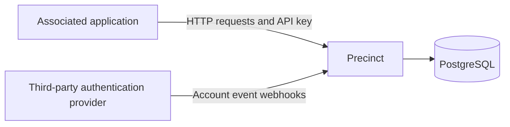

# Architecture specification

## Architectural goals

Each Precinct instance supports a single product and provides organisation, membership, and common user account capabilities to its associated application through an API-key-secured HTTP API. The application performs CRUD operations on Precinct records through that API and exclusively controls organisations through it. Precinct also receives account events at a webhook endpoint for third-party authentication providers. It delegates authentication to third-party providers, with Clerk supported in the first release. The implementation uses C#, hexagonal architecture, PostgreSQL, and Docker Compose.

The architecture should keep business rules independent of delivery mechanisms, identity providers, and persistence, while preserving the boundaries between tenant records and securing its integration endpoints. Human users do not access Precinct directly.

## System context

The diagram is logical: the exact authentication protocol, request flows, and deployment topology remain to be selected. Precinct owns its organisation, membership, account, and external identity associations; the provider owns authentication and its external identity.

## Hexagonal structure

- **Domain:** Organisation, user account, membership, and external identity concepts and their invariants. Domain code has no dependency on PostgreSQL, HTTP, Docker, or a specific identity provider.
- **Application:** Use cases coordinate domain operations, transaction boundaries, and ports. Inbound ports expose use cases; outbound ports express required persistence and other external capabilities.
- **Inbound adapters:** The service's delivery interface translates authenticated client requests into application use cases and maps outcomes to responses. A separate webhook endpoint receives provider account events and translates verified events into application use cases. The HTTP API style and contracts are not yet specified.
- **Outbound adapters:** PostgreSQL persistence and any required external integrations implement application ports. Provider-specific webhook validation and configuration stay in the relevant adapter.
- **Composition root:** The host configures dependency injection, adapters, settings, and service lifecycle.

Dependencies point inward: adapters depend on application ports and domain concepts, while domain rules do not depend on adapters. The exact project and namespace layout is an implementation decision.

## Data and consistency

PostgreSQL is the system of record for Precinct-owned data. Precinct exposes stable UUID identifiers for its records through the client API. Organisations and user accounts have stable UUIDs assigned on creation. Organisations have a name, owner account, and optional description and metadata. Accounts have a name, display name, and optional email and metadata. Metadata is opaque JSON whose contents are owned, validated, and handled by the client application; Precinct checks that it is valid JSON but does not interpret roles or other metadata contents. Precinct validates required fields and references, including non-blank names and the format of optional email addresses, and enforces the field limits in the functional specification. Memberships associate accounts with organisations; external identities associate a provider and provider subject with an account. Persistence must enforce uniqueness for organisation/user membership and provider/subject identity pairs, including under concurrent requests. Foreign keys and transactions should preserve referential integrity and the invariants of each operation.

Ownership transfers use a dedicated API endpoint. Organisation deletion is a two-stage process: an API request flags and suspends the organisation, and a later sweep permanently erases it and all child data. Removing the deletion flag before the sweep leaves the organisation suspended; unsuspension is a separate operation. The sweep must preserve shared accounts and other records that are not children of the organisation, even when they are referenced by memberships. Organisation changes originate from client API requests, while account lifecycle changes can originate from either API requests or provider webhooks; both paths must preserve the same domain invariants. Account updates from either source must be idempotent and use timestamps to prevent older updates from overwriting newer state; processing must account for duplicate and out-of-order events. The event mappings, timestamp source, precision, equal-timestamp and deletion handling, sweep scheduling, durable processing and reconciliation strategy, schema, migration tooling, account deletion semantics, pagination, and concurrency strategy are to be specified during implementation. Provider subjects should be stored in a form that preserves their provider-defined identity semantics.

The Clerk adapter handles `user.created`, `user.updated`, and `user.deleted` events and translates them into account lifecycle use cases using the field mapping in the functional specification. Clerk user IDs are external identifiers, not Precinct UUIDs, and webhook updates preserve application-owned metadata. Clerk webhooks are asynchronous and may be delayed or retried. Account synchronisation is therefore eventually consistent; synchronous client flows must not depend on immediate webhook delivery.

## Security boundaries

The HTTP inbound adapter validates the application API key before dispatching protected CRUD requests. The Clerk webhook adapter verifies event signatures using its configured signing secret and the provider’s prescribed verification mechanism; it does not rely on the application API key. Precinct does not authenticate human users for API access; the client application handles end-user authorisation in the product. Use cases and persistence queries must preserve the organisation scope of tenant records. The authenticated client application has full authority over product-level operations; Precinct does not impose product-level permissions or policy constraints. Data validation, referential integrity, and the specified lifecycle and security rules still apply.

Secrets and provider configuration are supplied at deployment time, not committed to source control. Logs should avoid credentials and unnecessary personal data. Transport security, audit requirements, and production secret management must be defined for the deployment environment.

## Proposed API key handling

Each instance maintains a small set of independently revocable keys for its associated application. Keys authenticate the application and have access to the client API; they do not represent human users. Provider webhooks use their own verification mechanism.

- Generate each key with a cryptographically secure random generator using at least 256 bits of entropy. Give it a non-secret identifier and a format such as `precinct_<key-id>_<secret>`; the identifier selects the stored verifier.
- Store only the identifier, a SHA-256 hash of the random secret, creation time and revocation status in PostgreSQL. Never store or log the plaintext key. Compare verifiers in constant time.
- Create keys through an operator-only administrative command run against the instance, separate from the client API. Display the plaintext key once, at creation, and deliver it to the application through a deployment secret manager or another secure channel. Bootstrap and operator access are deployment responsibilities.
- Send the key in an `Authorization: Bearer <key>` header over TLS. Reject missing, malformed, revoked, or invalid keys without exposing which verification step failed. Never put keys in URLs or logs.
- Rotate by creating a second key, updating the application to use it, and revoking the old key after the transition. Revocation takes effect on subsequent requests. If a key is compromised, revoke it immediately and issue a replacement.
- Record key identifiers and lifecycle actions in audit logs without recording secrets. Protect administrative access, configuration, and database backups; rate-limit failed authentication attempts where practical.

Keys do not expire; they remain valid until revoked. The administrative command interface and precise deployment secret mechanism remain to be defined.

## Audit logging

Persist audit records for API key lifecycle actions, including creation, rotation and revocation, and for domain entity lifecycle events. Include the event type and time, affected entity or key identifier, and action source where available; never include key secrets. Account events from both the API and provider webhooks must be covered, along with organisation ownership transfers, suspension changes, deletion flag changes, and sweeps.

Audit logs are written to files partitioned by date, with configurable retention defaulting to 90 days. Store them on persistent storage accessible to the service across container restarts. For database-backed changes, record an audit event in a transactional outbox in the same transaction as the state change; a background process writes pending events to the appropriate dated file and retries failures. Give events stable identifiers so retries can be recognised, and retain pending events until safely delivered. File delivery is asynchronous and may lag the change. Define the file format, date boundary, duplicate handling, rotation event representation, access controls, and change details during implementation. Retention and deletion policies must account for audit records when organisation child data is swept.

## Deployment and operations

Docker Compose defines the service and PostgreSQL deployment, including configuration and persistent database storage. The service receives database connection and provider settings, including the Clerk webhook signing secret, from its environment or deployment-managed secrets. Database readiness, schema migration execution, backups and restores, health checks, and upgrade procedures need to be designed before production use. Compose does not by itself specify production availability or recovery guarantees.

## Key decisions still required

- HTTP API style, versioning, error format, and client integration contracts.
- Clerk identity linking and webhook operational handling; future provider integrations.
- API key administrative interface.
- PostgreSQL schema, migration ownership, and data lifecycle.
- Operational targets for availability, observability, backup, and recovery.
