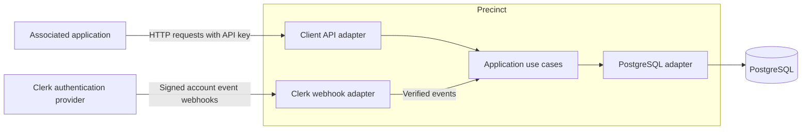

# Architecture specification

## Architectural goals

Each Precinct instance supports a single product and provides organisation, membership, and mirrored user account capabilities to its associated application through an API-key-secured HTTP API. The application controls organisations and memberships and can read account mirrors and manage their application-owned metadata. Clerk owns user accounts and their profile data; Precinct receives account events at a webhook endpoint and delegates authentication to Clerk. The implementation uses C#, hexagonal architecture, PostgreSQL, and Docker Compose.

The architecture should keep business rules independent of delivery mechanisms, identity providers, and persistence, while preserving the boundaries between tenant records and securing its integration endpoints. Human users do not access Precinct directly.

## System context

The diagram is logical; detailed request flows and deployment topology remain to be selected. Precinct owns organisation and membership records and stores a local mirror identified by the Clerk user ID. Clerk owns the account, profile data, and authentication; the client application owns Precinct account metadata.

## Hexagonal structure

- **Domain:** Organisation, user account, membership, and external identity concepts and their invariants. Domain code has no dependency on PostgreSQL, HTTP, Docker, or a specific identity provider.
- **Application:** Use cases coordinate domain operations, queries, and transaction boundaries. Inbound ports expose use cases; outbound ports express required persistence and other external capabilities.
- **Inbound adapters:** The service's delivery interface translates authenticated client requests into application use cases and maps outcomes to responses. A separate webhook endpoint receives provider account events and translates verified events into application use cases. The HTTP API style and contracts are not yet specified.
- **Outbound adapters:** PostgreSQL persistence and any required external integrations implement application ports. Provider-specific webhook validation and configuration stay in the relevant adapter.
- **Composition root:** The host configures dependency injection, adapters, settings, and service lifecycle.

Dependencies point inward: adapters depend on application ports and domain concepts, while domain rules do not depend on adapters. The exact project and namespace layout is an implementation decision.

## Data and consistency

PostgreSQL is the system of record for Precinct-owned data and stores the local Clerk account mirror. Precinct exposes stable UUID identifiers for its records through the client API. Organisations and account mirrors have stable UUIDs assigned on creation. Organisations have a name, owner account, and optional description and metadata. Account mirrors have a Clerk-owned name and optional email, plus application-owned metadata. Metadata is opaque JSON whose contents are owned, validated, and handled by the client application; Precinct checks that it is valid JSON but does not interpret roles or other metadata contents. Precinct validates required fields and references, including non-blank names and the format of optional email addresses, and enforces the field limits in the functional specification. Memberships associate account mirrors with organisations; each Clerk user ID identifies at most one mirror. Uniqueness, referential integrity, and the invariants of each operation must hold under concurrent requests.

### Persistence and concurrency

PostgreSQL tables store the current state of organisations, account mirrors, memberships, and their Clerk identifiers. Use cases read and update those records through persistence ports. Database constraints and transactions enforce uniqueness, references, and operation invariants under concurrent requests. API updates use an expected record version, compared and advanced atomically; mismatches result in a conflict. Webhook changes advance the account mirror version as well. Define the schema, transaction boundaries, and operations subject to version checks before implementation.

Queries read the stored records. Audit entries are stored separately in PostgreSQL; they are not the source of domain state.

### Lifecycle and consistency

The client controls organisations through the API, including ownership transfer through a dedicated endpoint. Clerk events create and maintain account mirrors; the client may update application-owned mirror metadata but cannot provision accounts, change Clerk profile fields, or delete accounts through Precinct. Invitations are out of scope.

An API deletion request marks an organisation pending deletion. After a grace period, a sweep permanently erases it and its child data while preserving shared account mirrors. Organisation deletion may be cancelled before the sweep. A Clerk deletion event marks the corresponding account mirror pending deletion for a later sweep. The client application determines the product-level effects of pending deletion. Erasure must also cover backups and other retained copies according to a defined policy. The grace period, cancellation rules for account mirrors, and backup restoration procedure remain to be designed before implementation.

Duplicate webhook deliveries are handled idempotently. Webhook ordering and reconciliation are separate from API version checks and remain to be defined.

### Clerk integration

The first release handles Clerk `user.created`, `user.updated`, and `user.deleted` events through a Clerk-specific inbound webhook adapter with a small application boundary. Deletion marks the account pending deletion for a later sweep. Clerk user IDs are external identifiers, distinct from Precinct UUIDs. The adapter uses the field mapping in the functional specification and preserves application-owned metadata. Clerk webhooks are asynchronous and may be delayed or retried, so synchronous client flows must not depend on immediate delivery.

## Security boundaries

The HTTP inbound adapter validates the application API key before dispatching protected CRUD requests. The Clerk webhook adapter verifies event signatures using its configured signing secret and the provider’s prescribed verification mechanism; it does not rely on the application API key. Precinct does not authenticate human users for API access; the client application handles end-user authorisation in the product. Use cases and persistence queries must preserve the organisation scope of tenant records. The authenticated client application has full authority over product-level operations; Precinct does not impose product-level permissions or policy constraints. Data validation, referential integrity, and the specified lifecycle and security rules still apply.

Secrets and provider configuration are supplied at deployment time, not committed to source control. Logs should avoid credentials and unnecessary personal data. API requests require TLS as described below; TLS termination and production secret management must be defined for the deployment environment.

## API key handling

Each instance accepts one deployment-configured API key for its associated application. The key authenticates the application and does not represent a human user. Provider webhooks use their own verification mechanism.

- Generate the key with a cryptographically secure random generator using at least 256 bits of entropy and provide it through deployment-managed secrets or another secure channel. Never commit or log the key.
- Send the key in an `Authorization: Bearer <key>` header over TLS. Compare credentials in constant time and reject missing, malformed, or invalid keys without revealing verification details. Never put keys in URLs.
- Rotate or revoke the key by replacing it in the service and application configuration. Because only one key is accepted, rotation requires coordination and may interrupt requests. Protect configuration and rate-limit failed authentication attempts where practical.

## Audit logging

Persist audit records in a PostgreSQL table for domain entity lifecycle actions. Record that an action occurred without change details or key secrets. Account changes from both the API and provider webhooks must be covered, along with organisation ownership transfers, pending deletion, cancellation, and sweeps. Key management happens in deployment configuration rather than through Precinct's API.

Write each audit record in the same database transaction as its state change. Retention is configurable and defaults to 90 days. Define the minimal audit fields, cleanup procedure, and access controls during implementation.

## Deployment and operations

Docker Compose defines the service and PostgreSQL deployment, including configuration and persistent database storage. The service receives the API key, database connection and provider settings, including the Clerk webhook signing secret, from its environment or deployment-managed secrets. Database readiness, schema migration execution, backups and restores, health checks, and upgrade procedures need to be designed before production use. Compose does not by itself specify production availability or recovery guarantees.

## Key decisions still required

Outstanding architectural and product decisions are tracked in [Specification issues](issues.md).
