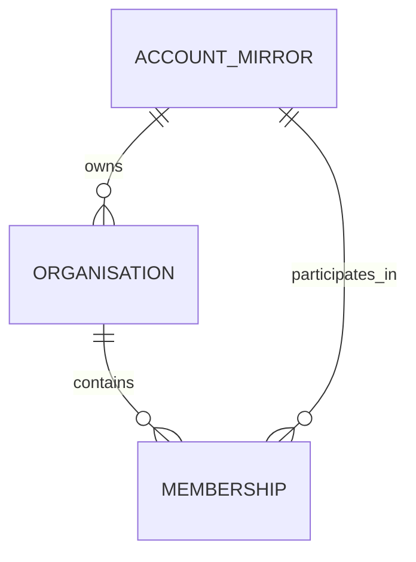

# Domain model

This document describes the domain concepts and currently agreed rules for Precinct. The [functional specification](functional-specification.md) defines product behavior, and [specification issues](issues.md) tracks unresolved decisions. The model describes concepts, not a database schema or API contract.

## Context

Each Precinct instance serves one product. Its client application controls organisations and memberships and handles human user authorisation. Clerk owns and authenticates user accounts; Precinct maintains local account mirrors for tenancy operations. Human users do not access Precinct directly.

Each organisation has one owner account mirror. An account mirror may own multiple organisations and may have memberships in multiple organisations. Ownership and membership are distinct concepts; whether an owner must also be a member remains open. A membership belongs to one organisation and one account mirror, and the same pair cannot have more than one membership.

## Organisation

An organisation represents a tenant. It has a stable Precinct UUID, a name, an owner account mirror, and optional description and metadata. The client application creates and manages organisations and determines what ownership means in its product. Ownership is changed through a dedicated API operation.

Organisation names must contain a non-whitespace character and be at most 200 Unicode characters. Descriptions may be up to 2,000 Unicode characters. Organisation metadata is opaque JSON owned by the client application; Precinct does not interpret it or enforce roles stored in it.

An organisation can be marked pending deletion and the client can cancel that request before its sweep. After a grace period, a sweep permanently erases the organisation and its child data, including memberships, while preserving shared account mirrors. The grace period, operations allowed while deletion is pending, and sweep coordination remain open.

## Account mirror

An account mirror is Precinct's local representation of one Clerk user. It has a stable Precinct UUID, a unique Clerk user ID, a name, optional email, and optional client-owned metadata. The Clerk user ID identifies the mirror; email is not used for matching. Clerk is authoritative for account existence, name, and email. The client can manage Precinct metadata but cannot create or delete a Clerk account or change its profile through Precinct.

Name is required, must contain a non-whitespace character, and is limited to 200 Unicode characters. Email, when present, must be non-blank, have a valid format, and be no longer than 254 Unicode characters. Metadata is opaque JSON and is not overwritten by Clerk events.

Verified Clerk user events create and update the mirror; a Clerk deletion event marks it pending deletion for a later sweep. The initial sync of existing Clerk users, handling of missing or out-of-order events, and the effects of sweeping an owner or member remain open. Because delivery is asynchronous, a Clerk user may not yet have a mirror when the client needs it.

## Membership

A membership associates one account mirror with one organisation. It allows an account to participate in multiple organisations without duplicating the account mirror. The client application adds and removes memberships; Precinct prevents duplicate organisation/account pairs and preserves valid references under concurrent requests. Invitations are out of scope.

The rules for membership changes while either related record is pending deletion, and the effects of an account mirror sweep, remain open. Product-level permissions and roles are determined by the client application.

## Shared rules and boundaries

- **Identity:** Precinct exposes stable UUIDs for its records; Clerk user IDs are distinct from Precinct UUIDs. Membership identifier and API details remain open.
- **Metadata:** Organisation and account metadata can be any valid JSON value. The client owns its contents; Precinct does not infer meaning from it.
- **Concurrency:** API updates use an expected record version and fail with a conflict if it no longer matches. Successful changes advance the version; Clerk webhook changes also advance the affected account mirror's version. Which operations require a version remains open.
- **Audit:** Domain lifecycle actions, including account mirror changes from Clerk and client changes to account metadata, are recorded in a PostgreSQL audit table in the same transaction as the change. The audit field details and retention cleanup remain open; the default retention is 90 days.
- **Erasure:** A sweep erases the affected record and its child data as specified. Treatment of retained copies, audit data, and references embedded in opaque metadata remains open.

## External boundaries

The client application authenticates API requests with a deployment-configured API key and is responsible for product-level authorisation. Clerk sends signed account webhooks, which Precinct verifies separately from the API key. Precinct does not authenticate human users or issue their credentials. Reconciliation and failure handling for webhook delivery remain open.
